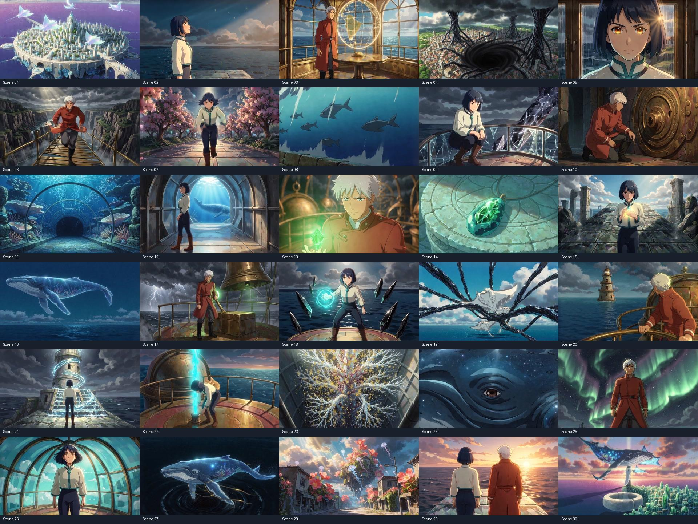

# VE_AiNubi_Workflow

A reusable VideoExpress workflow for an original narrated cinematic anime short.

## Example production

**MOONTIDE — The Glass Leviathan** follows Mira and Kael as they awaken a living lighthouse and a glass whale to save a floating ocean city. The target is 300 seconds: 30 unique scenes of 10 seconds each, landscape 16:9.

## Project settings

| Setting | Value |
|---|---|
| Aspect ratio | Landscape 16:9 |
| Creative Mode | Enabled |
| Scene duration | Manual, 10 seconds |
| Image style | Original cinematic 2D anime |
| Consistent Character | Enabled for scenes featuring the recurring cast |
| Automatic prompt enhancement | Disabled to preserve precise designs |
| Video sound | Disabled; narration and score mixed separately |
| Public gallery | Enabled for generated clips |
| Request batches | Five animation requests, then wait for all five to finish |

## Workflow

1. Write a complete beginning, escalating obstacle, discovery, climax, and resolution. Assign a different visual purpose and camera move to each shot.
2. Design original characters with simple, recognizable silhouettes and repeatable clothing. Generate and save clean master images before producing the story scenes.
3. Prepare an image prompt and a motion prompt for every scene. Include only the characters actually present. Use environmental cutaways to vary scale and pacing.
4. Enable Creative Mode, landscape 16:9, public sharing, Video Only, and manual 10-second duration. Verify the slider value before submitting.
5. Review candidate images. Reject extra people, wrong species, distorted anatomy, or major costume changes. Refine and regenerate the source image when needed.
6. Submit five animation requests sequentially as one batch. Wait until all five show completed media cards before submitting the next five. Never duplicate a job merely because a notification is late.
7. Save unsubmitted keyframes to My AI Images and record source selections so a browser interruption does not lose progress.
8. Generate original narration in separate passages using a licensed built-in voice. Leave action pauses between passages. Download the voice files from their visible Download controls.
9. Download completed clips through My AI Videos. Confirm public sharing from the clip menu: Make private indicates the generated clip is already public.
10. Review motion samples, retain clean takes, and edit major drift if necessary. Keep every final shot at exactly 10 seconds.
11. Mix narration with appropriately licensed music, lower music during speech, and add gentle opening and closing fades.
12. Assemble the film into one MP4, verify duration, resolution, audio, and successful full decoding, then inspect representative frames from every scene.
13. Upload the combined MP4 to the Videos folder, add it as one timeline clip, and save a uniquely named complete-film project. Preserve previous projects.

## Cast samples

### Mira

Mira, an adult female ocean guardian with a short straight midnight-blue bob, amber eyes, ivory cropped jacket with teal trim, dark navy trousers and brown boots, a small round turquoise pendant. One person only.

### Kael

Kael, an adult male navigator with short white hair, warm tan skin, green eyes, a rust-red long coat, charcoal trousers, black boots, no weapons. One person only.

## Prompt samples

Reusable visual style:

> Original premium cinematic 2D anime feature film, painterly detailed environments, refined expressive faces, dramatic volumetric lighting, coherent anatomy, widescreen 16:9. No text, no logos, no watermark.

### Scene 01

**Image prompt**

Aerial wide establishing view of a circular floating city built from white stone and sea glass above an endless violet ocean, giant luminous manta rays swimming through the air, crescent moon, no people.

**Motion prompt**

Aerial glide between towers toward an ancient dark lighthouse. Cloud shadows move across glowing tidal canals. Ten-second continuous cinematic anime shot. Preserve character design and clothing. No dialogue, no music, no sound, no text.

### Scene 07

**Image prompt**

Mira on a broad rooftop garden, leaning forward ready to sprint toward a distant light, tiny glowing jellyfish floating between flowering trees.

**Motion prompt**

Low tracking shot as Mira sprints along the wide rooftop walkway, jellyfish drifting aside. Ten-second continuous cinematic anime shot. Preserve character design and clothing. No dialogue, no music, no sound, no text.

### Scene 11

**Image prompt**

An EMPTY transparent glass tunnel through deep blue ocean, absolutely deserted floor, huge luminous book-shaped corals outside glass, ancient carved stone statues outside are inanimate stone, schools of tiny glowing fish. Architecture and underwater landscape only. No living humans anywhere, no silhouettes of visitors, no figures in tunnel.

**Motion prompt**

Smooth forward glide through the transparent passage while luminous sea creatures drift outside. Ten-second continuous cinematic anime shot. Preserve character design and clothing. No dialogue, no music, no sound, no text.

### Scene 18

**Image prompt**

Mira braced on a wide circular platform as black crystalline shards hover at a safe distance around her, pendant emitting a turquoise protective sphere.

**Motion prompt**

Slow orbit as shards dissolve into blue motes against the spherical light, Mira stands firmly. Ten-second continuous cinematic anime shot. Preserve character design and clothing. No dialogue, no music, no sound, no text.

### Scene 27

**Image prompt**

Extreme wide view of a solitary giant translucent blue HUMPBACK WHALE with rounded snout, long pectoral fins, whale tail, glowing stars and coral inside its glass body. It circles high above a black ocean whirlpool, fins trailing gold ribbons, darkness breaking into harmless sparkling droplets. No people, no riders.

**Motion prompt**

Majestic aerial tracking alongside leviathan as golden ribbons seal the whirlpool. Ten-second continuous cinematic anime shot. Preserve character design and clothing. No dialogue, no music, no sound, no text.

### Scene 29

**Image prompt**

Mira and Kael standing side by side on a wide sea-glass overlook, Mira ivory teal jacket and midnight bob, Kael red coat and short white hair, rear view only facing dawn, two people exactly.

**Motion prompt**

Slow pull-back behind the two guardians, both remain facing sunrise without turning, ocean shines below. Ten-second continuous cinematic anime shot. Preserve character design and clothing. No dialogue, no music, no sound, no text.

## Narration sample

Beyond the last charted shore, the city of Moontide drifted between ocean and sky. Its people trusted the old lighthouse to guide them through every storm. But its light had faded, and beneath the streets, something ancient had begun to wake. Mira felt it first: a pulse inside the pendant her mother had left her. Across the city, the navigator Kael watched the stars vanish from his map. The sea was no longer carrying their home. It was pulling it down.

## Thirty-scene storyboard

| Scene | Image direction | Camera and motion |
|---|---|

| 01 | Aerial wide establishing view of a circular floating city built from white stone and sea glass above an endless violet ocean, giant luminous manta rays swimming through the air, crescent moon, no people. | Aerial glide between towers toward an ancient dark lighthouse. Cloud shadows move across glowing tidal canals. |

| 02 | Mira stands at the edge of a sea-glass pier watching tiny golden plankton rise out of the water, medium side profile, quiet wonder. | Slow lateral tracking, Mira raises her gaze as the golden plankton drifts upward. |

| 03 | Inside a brass observatory, Kael studies a luminous spherical star map hovering above a round table, tall arched windows opening to ocean, medium shot. | Gentle orbit around Kael as the star map flickers and he looks suddenly concerned. |

| 04 | Wide view of a huge black whirlpool opening beneath the floating city, dark crystalline tendrils reaching toward its support pillars, storm clouds building, no people. | Slow dramatic descending crane toward the swirling abyss, tendrils rising gradually. |

| 05 | Close-up of Mira at a rain-spattered sea-glass window, her turquoise pendant glowing, reflected lighthouse in her amber eyes. | Slow dolly toward her determined face as the pendant pulses and distant lightning flashes. |

| 06 | Kael on a narrow suspended brass footbridge above a deep canyon of water, his red coat lifting in the storm, full body from three-quarter front. | Side tracking as Kael runs across the bridge, staying on solid planks, coat fluttering. |

| 07 | Mira on a broad rooftop garden, leaning forward ready to sprint toward a distant light, tiny glowing jellyfish floating between flowering trees. | Low tracking shot as Mira sprints along the wide rooftop walkway, jellyfish drifting aside. |

| 08 | Empty stone causeway split by a wall of rising water, translucent fish silhouettes suspended in the wave, colossal city towers behind, no people. | Camera tracks along the water wall as silver fish turn in synchronized spirals. |

| 09 | Mira crouches behind a waist-high curved sea-glass barrier on a terrace, a dark crystal energy beam striking the other side, clear hands and protective cover. | Slow push in as the crystal beam scatters into harmless sparks against the barrier, Mira remains sheltered. |

| 10 | Kael kneels beside a brass circular lock embedded in a huge ancient door, one hand on a glowing green circular dial, close medium profile. | Dolly toward the dial as Kael rotates it once and concentric door rings illuminate. |

| 11 | An EMPTY transparent glass tunnel through deep blue ocean, absolutely deserted floor, huge luminous book-shaped corals outside glass, ancient carved stone statues outside are inanimate stone, schools of tiny glowing fish. Architecture and underwater landscape only. No living humans anywhere, no silhouettes of visitors, no figures in tunnel. | Smooth forward glide through the transparent passage while luminous sea creatures drift outside. |

| 12 | Mira walks within the transparent underwater passage, luminous blue whale visible far beyond glass, full body side view, dry interior. | Side tracking with Mira walking slowly as the immense whale glides past outside. |

| 13 | Kael in a circular chamber lined with bronze orreries, holding a single small green crystal in his open palm, medium close-up. | Camera gently pushes toward the crystal as its light illuminates Kael’s thoughtful face. |

| 14 | Macro view of a green crystal fitting inside a turquoise pendant resting on a weathered stone altar, glowing veins connect them, no faces or bodies. | Locked macro shot as the crystal settles and rings of soft turquoise light ripple across the altar. |

| 15 | Mira stands on a broad staircase ascending from submerged ruins toward open sky, holding her newly glowing pendant against her chest, rear three-quarter view. | Crane upward following Mira climbing several steps, water sparkles around the stairwell. |

| 16 | A solitary gigantic translucent blue whale levitates far above empty open ocean at midnight. Wide shot of whole whale silhouette with long graceful fins. Its transparent body contains only abstract tiny stars and glowing coral branches. Empty ocean and sky, absolutely no humans, no riders, no people, no buildings inside the whale. Closed calm eye. | Slow majestic orbit around the sleeping leviathan, interior constellations pulse softly. |

| 17 | Kael stands at a brass signal platform beneath a huge bell, reaching toward a green-lit control lever, storm in background, medium view. | Kael pulls the single lever down; the bell radiates visible green light rings into the clouds. |

| 18 | Mira braced on a wide circular platform as black crystalline shards hover at a safe distance around her, pendant emitting a turquoise protective sphere. | Slow orbit as shards dissolve into blue motes against the spherical light, Mira stands firmly. |

| 19 | Extreme wide sky battle of luminous manta rays weaving between dark crystalline tendrils above ocean, no riders, no people, abstract magical energy, no gore. | Dynamic lateral aerial glide following one manta as it slips through an opening and sheds bright particles. |

| 20 | Kael holding tightly to a sturdy bronze railing on a swaying observatory balcony, green light reflected in his eyes, medium close-up. | Subtle camera sway as Kael steadies himself and looks toward the awakened lighthouse. |

| 21 | Mira on the broad base of an ancient lighthouse, a towering spiral of luminous water forming a stairway before her, wide rear view. | Crane upward as the spiral staircase assembles step by step from glowing water. |

| 22 | Mira at a high circular lighthouse terrace, her pendant hovering just above an empty round pedestal, medium side view, clear simple pose. | Slow push as Mira lowers the pendant into the pedestal and a turquoise light column ignites upward. |

| 23 | Interior lighthouse core, a giant living tree made of luminous coral unfurling crystalline branches through a vertical chamber, no people. | Upward tilt following the coral tree blooming and scattering golden spores. |

| 24 | Extreme cinematic close-up of the head of a giant translucent blue HUMPBACK WHALE, recognizable rounded broad whale snout with small tubercles and throat pleats, one SMALL calm whale eye near the corner of the mouth. No fish scales, no gills, no fish fins, no giant human eye. Star constellations shimmer inside transparent blue whale skin, midnight sky and moon behind, no people. | Slow dolly toward the eye as it opens calmly and reflects the shining city. |

| 25 | Kael on a wide rooftop signal platform, arms lowered as emerald aurora sweeps overhead, low-angle medium shot, face clearly visible. | Camera cranes upward from Kael toward streams of emerald light connecting the city towers. |

| 26 | Mira standing firmly on the lighthouse terrace inside a brilliant turquoise dome, hair gently windswept, brave calm expression, medium close-up. | Slow cinematic push as Mira closes her eyes briefly, then looks up while the dome expands. |

| 27 | Extreme wide view of a solitary giant translucent blue HUMPBACK WHALE with rounded snout, long pectoral fins, whale tail, glowing stars and coral inside its glass body. It circles high above a black ocean whirlpool, fins trailing gold ribbons, darkness breaking into harmless sparkling droplets. No people, no riders. | Majestic aerial tracking alongside leviathan as golden ribbons seal the whirlpool. |

| 28 | Floating city channels bloom with radiant coral flowers and flying jellyfish, morning sunlight breaking through clouds, abandoned empty streets, no people. | Smooth forward glide through the restored canal city, luminous flowers opening along the banks. |

| 29 | Mira and Kael standing side by side on a wide sea-glass overlook, Mira ivory teal jacket and midnight bob, Kael red coat and short white hair, rear view only facing dawn, two people exactly. | Slow pull-back behind the two guardians, both remain facing sunrise without turning, ocean shines below. |

| 30 | Extreme wide sunrise above a circular floating white stone and sea-glass city over violet ocean. Giant translucent blue HUMPBACK WHALE with long pectoral fins and star-filled coral inside body ascending among luminous manta rays. Central white lighthouse beams into rose-gold sky. No people, no riders, no foreground characters. | Long graceful crane pull-back revealing the whole restored ocean kingdom beneath the rising sun, gentle final hold. |

## Audio and rights record

The example uses the recording **The Hope** by **TAD**, identified as CC0 on its [creator upload page](https://opengameart.org/content/the-hope), verified October 14, 2026. [CC0 license](https://creativecommons.org/publicdomain/zero/1.0/). This dedication applies to the music recording; it does not declare generated animation or synthesized narration to be CC0. Keep a copy of the applicable service terms and source license with each production. No guarantee is made about automated platform claims.

## Practical limitations

Generated faces, equipment, architecture, and clothing may vary slightly despite references. Precise shot descriptions are targets, not guarantees. Evaluate the actual generated frames and motion. VideoExpress library duration labels were unreliable during this production; verify the downloaded MP4 metadata. Public sharing was available for generated clips. The uploaded combined-film menu did not expose a public-gallery action.

## Verification record

Completed October 18, 2026. The final MP4 is **300.000 seconds**, **1920×1080**, **24 fps**, with one stereo audio track containing narration and CC0 music. Full video/audio decoding passed. Representative frames from all 30 scenes were visually inspected; this was sampled visual review, not a full real-time listening review. Minor generated design and architecture variations remain.

[Download a 10-second animation sample](MOONTIDE_Sample_10s.mp4). The sample is a silent scene; the complete movie includes narration and music.

[Music license record](MOONTIDE_Music_License.md).
